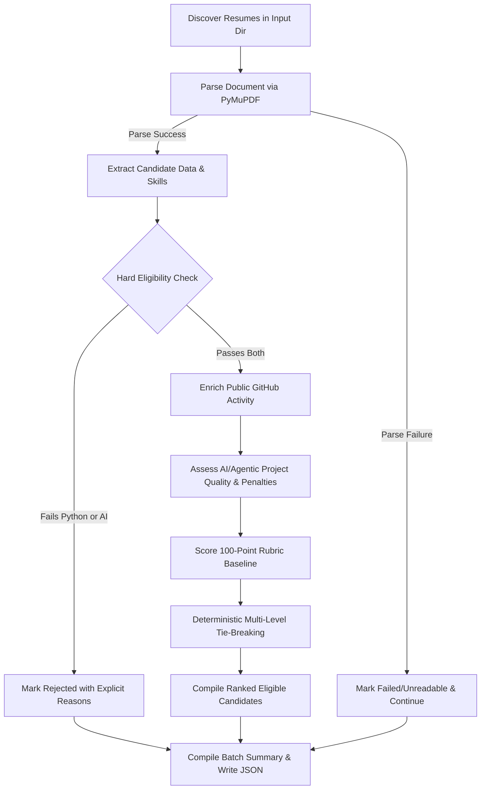

# AI Resume Screening & Ranking System

An explainable, production-grade batch screening and ranking system built in Python for evaluating engineering intern candidates (specifically tailored for SDE Intern roles requiring Python and AI/agentic engineering).

---

## 1. Project Overview

The **AI Resume Screening & Ranking System** automates the ingestion, parsing, semantic extraction, hard eligibility verification, GitHub profile enrichment, and 100-point rubric scoring of candidate resumes in batch.

It is designed with an emphasis on:
- **Resilience**: A malformed resume, failed LLM call, or rate-limited GitHub API request never crashes the batch.
- **Explainability**: Every scoring decision produces tangible reasons, matched skills, strengths, and concerns.
- **Determinism**: Hard constraints and multi-level tie-breakers produce fully reproducible rankings.
- **Extensibility**: Provider adapters allow switching between Gemini, OpenAI, and offline heuristic evaluation with zero code refactoring.

---

## 2. Problem Statement

Recruitment teams receive hundreds of developer resumes for AI/Software engineering roles. Traditional keyword-based ATS tools fail because:
1. They award points to buzzwords without assessing whether an AI project is a thin wrapper or a real agentic/RAG implementation.
2. They do not cross-reference candidate claims against public engineering activity (e.g., GitHub).
3. Monolithic scripts crash when encountering unexpected PDF font encodings or external API rate limits.

This system addresses these challenges through a two-stage funnel: **deterministic hard filtering** followed by **explainable rubric ranking**.

---

## 3. Architecture

```
AI-Resume-Screening/
│
├── resumes/                 # Input directory containing candidate PDF resumes
├── src/
│   ├── __init__.py          # Package initialization
│   ├── config.py            # Typed application configuration & environment management
│   ├── models.py            # Pydantic v2 schemas for parsing, enrichment, and output
│   ├── parser.py            # PyMuPDF-based fault-tolerant text extraction
│   ├── extractor.py         # Multi-pass semantic resume extractor (LLM + heuristic fallback)
│   ├── eligibility.py       # Deterministic hard eligibility evaluator
│   ├── github.py            # GitHub API client with rate-limit detection and caching
│   ├── llm.py               # Adapter interface supporting Gemini, OpenAI, & heuristic fallback
│   ├── scorer.py            # 100-point rubric evaluator and deterministic tie-breaker
│   ├── pipeline.py          # Batch orchestrator
│   └── utils.py             # Logging, text sanitization, and username parsing
│
├── tests/
│   ├── test_eligibility.py  # Hard filter verification (Python, AI, polyglot cases)
│   ├── test_scoring.py      # Rubric caps, shallow wrapper penalties, tie-breaking
│   └── test_parser.py       # Fault tolerance on malformed PDFs and TXT files
│
├── output/
│   └── results.json         # Generated machine-readable screening output
│
├── main.py                  # CLI entrypoint with real-time progress and summary report
├── requirements.txt         # Pinned production dependencies
├── .env.example             # Template for API keys and environment variables
├── .gitignore               # Ignored build, cache, and credential files
└── README.md                # System documentation
```

### Pipeline Flow



---

## 4. Setup

### Prerequisites
- Python 3.11 or higher
- Git

### Clone or Open Workspace
```bash
cd AI-Resume-Screening
```

---

## 5. Installation

Install all required dependencies using `pip`:

```bash
pip install -r requirements.txt
```

Core dependencies:
- **`pymupdf`**: High-performance, memory-efficient PDF text extraction.
- **`pydantic`**: Strict schema validation, typing, and serialization.
- **`python-dotenv`**: Safe `.env` loading.
- **`requests`**: HTTP requests for GitHub REST API and LLM endpoints.
- **`pytest`**: Comprehensive automated test runner.

---

## 6. Environment Variables

Create a `.env` file in the project root by copying `.env.example`:

```bash
cp .env.example .env
```

Configure your variables as needed:

| Variable | Required | Description |
|---|---|---|
| `LLM_PROVIDER` | Optional | `groq`, `gemini`, `openai`, or `heuristic` (default: `auto`) |
| `GROQ_API_KEY` | Optional | Groq API key for ultra-fast, high-throughput LLM inference |
| `GROQ_MODEL` | Optional | Groq model name (default: `qwen/qwen3.8-27b`) |
| `GEMINI_API_KEY` | Optional | Google Gemini API key for semantic analysis |
| `GEMINI_MODEL` | Optional | Gemini model name (default: `gemini-1.5-flash`) |
| `OPENAI_API_KEY` | Optional | OpenAI / compatible endpoint API key |
| `OPENAI_BASE_URL` | Optional | API base URL (default: `https://api.openai.com/v1`) |
| `OPENAI_MODEL` | Optional | OpenAI model name (default: `gpt-4o-mini`) |
| `GITHUB_TOKEN` | Optional | GitHub personal access token (increases rate limit from 60 to 5,000 req/hr) |
| `LOG_LEVEL` | Optional | Logging verbosity: `DEBUG`, `INFO`, `WARNING`, `ERROR` |

> **Note**: The system works out of the box even without any external API keys configured, utilizing its deterministic heuristic provider. When API keys are supplied, it automatically upgrades to LLM-powered extraction and quality auditing.

---

## 7. How to Run

Run the screening pipeline from the command line:

```bash
python main.py --input ./resumes --output ./output/results.json
```

### CLI Arguments
- `--input`, `-i`: Directory containing resumes or path to an individual resume file (default: `./resumes`).
- `--output`, `-o`: Destination path for the generated JSON report (default: `./output/results.json`).
- `--provider`, `-p`: LLM provider choice: `auto`, `gemini`, `openai`, `heuristic` (default: `auto`).
- `--verbose`, `-v`: Enables debug-level logging.

---

## 8. Example Command

```bash
python main.py --input ./resumes --output ./output/results.json
```

Sample CLI Output:
```text
================================================================================
   AI Resume Screening & Ranking System — SDE Intern Evaluation Engine
================================================================================
    
[13:54:46] [INFO] [parser]: Discovered 50 resume file(s) in ./resumes
[13:54:46] [INFO] [pipeline]: Starting batch screening on 50 resume(s)...
  [50/50] (100.0%) Processing: candidate_50.pdf              
[13:55:03] [INFO] [pipeline]: Machine-readable results written to output\results.json

================================================================================
 BATCH SCREENING SUMMARY
================================================================================
  Total Resumes Discovered : 50
  Successfully Parsed      : 50
  Eligible for Ranking     : 34
  Rejected (Ineligible)    : 16
  Failed / Unreadable      : 0
--------------------------------------------------------------------------------

TOP RANKED ELIGIBLE CANDIDATES (Top 10 Preview):
 Rank  | Candidate Name             | Total  | AI (40)  | Py (30)  | Cloud  | GH  
---------------------------------------------------------------------------
 1     | Yash Maini                 | 88.0   | 40.0     | 26.0     | 9.5    | 10.0
 2     | Prathamesh                 | 86.0   | 40.0     | 26.0     | 15.0   | 0.0 
 3     | V Sree Raghu Vardhan       | 86.0   | 40.0     | 26.0     | 15.0   | 0.0 
 4     | Hari Shanker Sharma        | 84.5   | 40.0     | 26.0     | 15.0   | 0.0 
 5     | Arjun Kumar                | 82.0   | 40.0     | 21.5     | 9.0    | 10.0
 6     | Gourab Das                 | 81.0   | 29.0     | 26.0     | 13.0   | 9.0 
 7     | Kiran Naregal              | 78.0   | 40.0     | 18.0     | 11.0   | 8.0 
 8     | Vaibhav Wakde              | 74.5   | 40.0     | 22.0     | 7.5    | 0.0 
 9     | PRAJWAL A S                | 72.5   | 36.0     | 22.0     | 3.5    | 10.0
 10    | ABHINAV MISHRA             | 71.5   | 29.0     | 22.5     | 9.0    | 10.0
 ... and 24 more eligible candidates (see full JSON).

SAMPLE REJECTED CANDIDATES (Non-Competitive):
  * Kartikay Sinha           -> Missing genuine Python evidence across skills, projects, and work experience; Missing meaningful AI/LLM/RAG/agentic project, framework, or implementation evidence
  * SHIVAM RAJ               -> Missing genuine Python evidence across skills, projects, and work experience; Missing meaningful AI/LLM/RAG/agentic project, framework, or implementation evidence
  * Agam Jain                -> Missing meaningful AI/LLM/RAG/agentic project, framework, or implementation evidence
...
```

---

## 9. Output Format

The output JSON file contains `batch_summary` and `candidates`:

```json
{
  "batch_summary": {
    "total_resumes": 50,
    "successfully_parsed": 50,
    "eligible": 34,
    "rejected": 16,
    "failed_unreadable": 0
  },
  "candidates": [
    {
      "rank": 1,
      "candidate_name": "Yash Maini",
      "eligible": true,
      "total_score": 88.0,
      "score_breakdown": {
        "ai_project_depth": 40.0,
        "python_backend": 26.0,
        "cloud_fullstack": 9.5,
        "github": 10.0,
        "engineering_depth": 2.5
      },
      "matched_skills": [
        "AI Agents",
        "AWS",
        "Docker",
        "FastAPI",
        "LangChain",
        "LangGraph",
        "Multi-Agent Workflows",
        "Pinecone",
        "Python",
        "RAG"
      ],
      "project_summary": "Key projects: CopyGuard – Serverless GenAI Code Detection Platform, ThreatMatrix – MLOps Pipeline.",
      "github_summary": "Active profile @Yashmaini30 with 47 public repos. Latest activity: Oct 2026 (5.0/5 pts). Identified 9 relevant/Python/AI repos (5.0/5 pts).",
      "strengths": [
        "Stateful multi-agent architecture or orchestration framework identified",
        "Retrieval-Augmented Generation (RAG) and vector database integration demonstrated",
        "Modern asynchronous API design with FastAPI",
        "Public GitHub engineering record (10.0/10 pts)"
      ],
      "concerns": [
        "No explicit automated testing or Pytest evidence mentioned"
      ]
    },
    {
      "candidate_name": "Kartikay Sinha",
      "eligible": false,
      "rejection_reasons": [
        "Missing genuine Python evidence across skills, projects, and work experience",
        "Missing meaningful AI/LLM/RAG/agentic project, framework, or implementation evidence"
      ],
      "matched_skills": [
        "C++",
        "Express.js",
        "JavaScript",
        "MongoDB",
        "Next.js",
        "React",
        "TypeScript"
      ]
    }
  ]
}
```

---

## 10. Eligibility Logic

A candidate is marked **eligible** if and only if **BOTH** conditions are satisfied:

### Condition A: Python Evidence
- Python must appear as a genuine skill, project implementation language, work experience technology, or backend stack.
- Filtered using regex boundaries `\b(python|python3|py)\b`.
- Phrases like `"No Python experience"` are explicitly recognized as negations and rejected.

### Condition B: AI / Agentic Evidence
- The resume must demonstrate at least one meaningful AI/LLM/RAG/agentic project, framework, or implementation:
  - Frameworks: LangChain, LangGraph, Google ADK, LlamaIndex, CrewAI, AutoGen.
  - Architectures: RAG, Retrieval-Augmented Generation, vector embeddings, vector search, semantic search.
  - Vector stores: Pinecone, ChromaDB, FAISS, Weaviate, Qdrant, Milvus.
  - Agentic systems: Tool calling, function calling, multi-agent workflows, stateful graphs.
  - Evaluation & optimization: Ragas, TruLens, custom fine-tuning, Ollama/vLLM.

> **Polyglot Protection**: Candidates who have Java, React, TypeScript, C++, etc., are **never** rejected if Python + AI evidence is also present.

---

## 11. Scoring Methodology

Eligible candidates are ranked against a strict **100-point rubric baseline**:

| Category | Max Points | Evaluation Signals |
|---|---|---|
| **AI / Agentic / RAG Project Depth** | **40** | Multi-agent workflows, LangGraph, RAG vector retrieval, tool use, eval pipelines. **Penalizes shallow wrappers by 5–15 pts**. |
| **Python & Backend Engineering** | **30** | FastAPI (+10), Django (+9), Flask (+8), databases (PostgreSQL/MongoDB/Redis), async/concurrency. |
| **Cloud / Deployment / Full Stack** | **15** | Docker (+4), Kubernetes (+2), AWS/GCP/Azure (+3.5), CI/CD (+2), frontend integration (+3.5). |
| **GitHub Activity** | **10** | Public profile signals: recent activity (0–5 pts) + maintained Python/AI repos (0–5 pts). |
| **Engineering Depth Signals** | **5** | Pytest / automated unit testing (+2.5), system design / architecture (+1.5), monitoring/logging (+1.0). |

### Shallow Wrapper Penalization
Candidates who submit simple OpenAI API wrappers (e.g., passing a basic prompt to ChatGPT in Streamlit without retrieval, state management, or tool calling) are penalized by **5 to 15 points** in the AI Project Depth category. Candidates who list AI in their skills but have zero project implementation receive a **12-point deduction**.

### Deterministic Multi-Level Tie-Breaking
When candidates achieve equal total scores, ranks are deterministically resolved via:
1. `total_score` descending
2. `ai_project_depth` descending
3. `python_backend` descending
4. `candidate_name.lower()` alphabetically ascending

---

## 12. GitHub Enrichment

When a candidate's resume includes a public GitHub URL or username:
1. The username is parsed and checked against an in-memory cache to prevent duplicate HTTP calls.
2. The public GitHub REST API is queried:
   - `/users/{username}`: profile creation, update timestamps, public repository count.
   - `/users/{username}/repos?sort=updated&per_page=10`: latest commits, languages, repository descriptions, topics.
3. Scoring breakdown:
   - **Recent Activity (0 to 5 pts)**: Active within 60 days (5.0 pts), 180 days (4.0 pts), 1 year (3.0 pts), older (1.5 pts).
   - **Maintained & Relevant Repos (0 to 5 pts)**: Rewards repositories featuring Python, AI/ML, FastAPI, or active stars/forks.
   - Total capped strictly at **10 points**.
4. **Resilience**: If the GitHub API fails, rate-limits, or returns 404, the failure is recorded in `github_summary` and processing continues without penalty. A missing GitHub profile **never** disqualifies a candidate.

---

## 13. LLM Usage

The system leverages Large Language Models where semantic reasoning adds clear value:
- Extracting nuanced project architectures that rule-based regexes might miss.
- Differentiating between a thin LLM wrapper and deep agentic workflows.
- Synthesizing concise candidate strengths, concerns, and project summaries.

### Architecture: Provider Adapter Pattern
All LLM operations are routed through `BaseLLMProvider`:
- `GroqProvider`: Groq ultra-fast inference API (`qwen/qwen3.8-27b`).
- `GeminiProvider`: Google Gemini REST API (`gemini-1.5-flash`).
- `OpenAIProvider`: OpenAI and OpenAI-compatible endpoints (`gpt-4o-mini`, Together, Ollama).
- `HeuristicFallbackProvider`: Rule-based evaluator providing 100% offline functionality.

If an LLM API call times out or throws an error, the pipeline catches the exception, logs a warning, and activates the heuristic fallback for that resume.

---

## 14. Error Handling

Production-grade fault tolerance is built into every layer:
1. **Malformed & Corrupted PDFs**: PyMuPDF warning suppression prevents terminal clutter; invalid binary headers or corrupt PDFs are caught, logged, and classified as `failed_unreadable` without interrupting the batch.
2. **Missing Contact Data**: Resumes lacking phone numbers or GitHub links are handled gracefully with `None` defaults.
3. **API Rate Limiting**: Both GitHub and LLM clients handle HTTP 403, 429, and network timeouts safely, logging the incident and returning structured fallbacks.
4. **Encoding Errors**: Text files are parsed using UTF-8 with automatic fallback to Latin-1.

---

## 15. Testing

The test suite covers all core pipeline constraints:
- Python + AI candidate → eligible
- Python-only candidate → rejected
- AI-only candidate → rejected
- Java/React-only candidate → rejected
- Python + RAG candidate → eligible
- Shallow LLM wrapper → receives 5–15 pt penalty
- Missing GitHub → candidate remains eligible/scorable
- Malformed resume → batch continues uninterrupted

Run the test suite:
```bash
python -m pytest -v
```

Expected output:
```text
============================= test session starts =============================
platform win32 -- Python 3.11.9, pytest-9.1.1
collected 15 items

tests/test_eligibility.py::test_python_and_ai_candidate_eligible PASSED  [  6%]
tests/test_eligibility.py::test_python_only_candidate_rejected PASSED    [ 13%]
tests/test_eligibility.py::test_ai_only_candidate_rejected PASSED        [ 20%]
tests/test_eligibility.py::test_java_react_only_candidate_rejected PASSED [ 26%]
tests/test_eligibility.py::test_python_and_rag_candidate_eligible PASSED [ 33%]
tests/test_eligibility.py::test_polyglot_developer_with_java_react_and_python_ai_eligible PASSED [ 40%]
tests/test_parser.py::test_pdf_parsing_real_file PASSED                  [ 46%]
tests/test_parser.py::test_txt_parsing PASSED                            [ 53%]
tests/test_parser.py::test_malformed_resume_does_not_crash PASSED        [ 60%]
tests/test_parser.py::test_pipeline_continues_with_malformed_resume PASSED [ 66%]
tests/test_parser.py::test_discover_resumes_ordering PASSED              [ 73%]
tests/test_scoring.py::test_shallow_llm_wrapper_penalty PASSED           [ 80%]
tests/test_scoring.py::test_missing_github_candidate_remains_scorable PASSED [ 86%]
tests/test_scoring.py::test_score_caps_respected PASSED                  [ 93%]
tests/test_scoring.py::test_deterministic_tie_breaker PASSED             [100%]

============================= 15 passed in 0.74s ==============================
```

---

## 16. Design Decisions

### 1. Why Hard Filtering is Deterministic
LLMs are probabilistic and prone to hallucination, non-determinism, or token variations. Hard eligibility criteria (such as requiring genuine Python experience and AI project evidence) must be strictly verifiable and explainable to audit teams and candidates. Keeping hard filtering in deterministic Python code guarantees 100% reproducible decisions with zero false rejections from prompt drift.

### 2. Why LLM is Used for Semantic Extraction & Project Assessment
While regexes excel at pattern matching (emails, URLs, phone numbers), evaluating project complexity is inherently semantic. An LLM can distinguish whether a candidate genuinely architected a stateful agent with memory and retrieval, or simply copy-pasted a 10-line tutorial script.

### 3. Why Scoring is Explainable
Black-box scores erode recruiter trust. By breaking down the 100-point baseline into five transparent buckets (AI Project Depth: 40, Python Backend: 30, Cloud: 15, GitHub: 10, Engineering Depth: 5) and outputting exact `strengths` and `concerns`, hiring managers can immediately understand why Candidate A outranked Candidate B.

### 4. Why GitHub is Enrichment Rather Than Eligibility
Many exceptional engineers have private corporate repositories, NDAs, or limited public GitHub profiles. Requiring a public GitHub profile would unfairly disqualify qualified candidates. Capping GitHub at 10 points rewards public open-source signals without penalizing those without a public presence.

### 5. How Failures are Handled
The system adheres to an "isolate and continue" failure boundary. Each stage (PDF extraction, LLM analysis, GitHub lookup) is wrapped in scoped exception handlers. When an individual step encounters an error, it records a diagnostic message in the candidate record and proceeds.

---

## 17. If I Had More Time

If allocated additional development cycles, the following production enhancements would be added:
1. **Async / Concurrent Worker Pool**: Implement a bounded `asyncio` or `ThreadPoolExecutor` (e.g., 5 concurrent workers) to process large batches (500+ resumes) within seconds while respecting rate limits.
2. **OCR Fallback for Scanned Resumes**: Integrate `pytesseract` or `pdf2image` as a fallback extractor when PyMuPDF encounters image-only or non-selectable PDF resumes.
3. **Automated Plagiarism & GitHub Code Verification**: Clone and inspect candidates' public repositories to check for commit history, commit authorship, and code originality rather than relying strictly on metadata.
4. **Interactive HTML/CSV Dashboard**: Provide an automated `--format html` export flag that generates an interactive, sortable candidate evaluation table with visual score breakdown bars.
